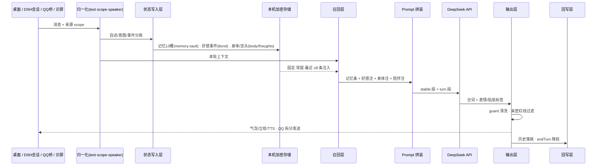
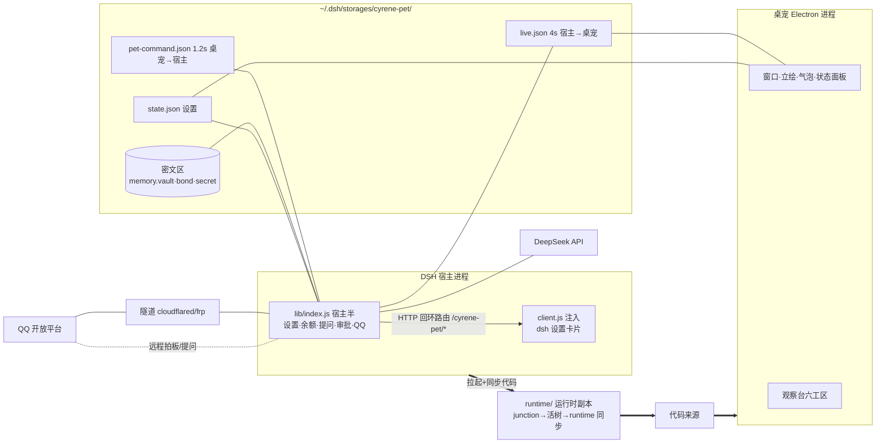
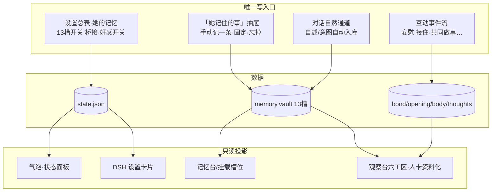

# dsh-cyrene-pet

昔涟桌面桌宠的 DeepSeek Harness（DSH）版：透明置顶的桌宠立绘，带气泡台词、状态面板、右键菜单，并接管 DSH 的对话提问、风险审批与任务进程。她会记住相处里要紧的事，会在合适的时候先开口，也能在你不在电脑前时把审批推到 QQ 上。

> 仓库名 `dsh-cyrene-balance` 是它最早做余额插件时留下的，包名与插件目录是 `dsh-cyrene-pet`。安装时认包名和目录，不认仓库名。

- 作者：**bestlike093** ｜ 平台：Windows ｜ 当前版本：**2.0.1**

## 她在你桌面上做什么

- 透明无边框的立绘贴在桌面，拖到屏幕边缘自动贴边，立绘以外的区域点击穿透，不挡你干活。
- 单击她说一句台词；长按她播报当前任务进度；说话时气泡跟口型。
- 形象随你：内置图片立绘起步，可换单图 / GIF / 视频 / 多帧 sprite / Live2D 五类素材；不想见立绘就切「只显示审批卡片」的卡片模式。
- 状态面板看 CPU / 内存 / GPU / 网速 / 电量 / DeepSeek 余额与今日消费。
- 她记得你：固定、常提、最近的记忆会带进新会话；日常发言里的自述和偏好也会自动记下。
- DSH 的提问与审批可以弹在她这里逐题回答，出门在外也能在 QQ 上拍板。

## 项目脉络：三张图

三张图各答一个问题：一条消息进来发生了什么（脉络）、两个进程怎么连在一起（拓扑）、每份数据谁写谁读（关系）。

### 脉络图 · 一次对话在她内部走的路



### 拓扑图 · 两个进程与它们之间的线



### 关系图 · 每份数据谁有唯一写权



## 三十秒上手

1. 从 [Releases](https://github.com/bestlike093/dsh-cyrene-balance/releases/latest) 下载最新安装包，解压到任意目录（例如 `D:\plugins\dsh-cyrene-pet`）。Release 页附 SHA-256，可核对完整性。
2. 注册插件并重启 dsh：

   ```bash
   dsh plugin --profile desktop add D:\plugins\dsh-cyrene-pet
   ```

3. 桌面上出现透明立绘、单击会说话，运行时就算起来了。
4. API Key 三处取其一，按顺序：设置面板里填的 → 环境变量 `DEEPSEEK_API_KEY` → `~/.dsh/.credentials.yaml`。已经用 dsh 登录过 DeepSeek 的机器不用再填。
5. 打开 dsh 设置页「昔涟 · 桌宠」卡片 →「数据」→ 点「刷新余额」，状态面板出现数字，握手完成。

从源码目录装法相同：`dsh plugin --profile desktop add <源码目录>`。

## 装好后先对照这几条

- **2.0.1 是整改版**：功能行为与 2.0.0 等价，新机制全部默认关闭；真机装载验证仍在进行，没看到 `register-ok` marker 请先反馈日志，不要继续配深层功能。详细说明见 Releases 页的 2.0.1。
- **卸载或重装 dsh 后**，桌宠运行时（`~/.dsh/storages/cyrene-pet/runtime/`）需要重新部署：关掉 dsh、删掉 `runtime/`、再启动，插件会自动重建。白屏、进程秒退多半是这个问题。
- 桌宠复用 dsh 自带的 Electron 运行时，不额外下载；若宿主以 `ELECTRON_RUN_AS_NODE=1` 跑 Node，先清掉这个环境变量。
- 审批只有「允许一次 / 拒绝」，没有「总是允许」。点允许等于授权 Agent 越权执行，看清工具名和理由再点。
- 密文数据绑本机：换电脑或换 Windows 用户后，陪伴数据要重新生成或走备份导入，直接拷 `~/.dsh/storages/cyrene-pet/` 是解不开的。
- dsh 大版本升级（插件 API、webServer、todos 投影变动）可能让对应功能失效——表现为卡片消失、面板没数字、提问不弹桌宠。先删 `runtime/` 重部署试一次，仍不行等适配或回退 dsh，并先备份数据目录。
- 同时装其他桌宠 / 窗口管理插件可能冲突（快捷键、托盘、窗口层级），请自行排查。
- 卸载插件不会自动删数据目录；想彻底清理再删 `~/.dsh/storages/cyrene-pet/`。

## 日常怎么用

### 形象、背景与卡片模式

入口都在设置 →「她的样子」。第一次打开有三步引导（挑形象 / 填 Key / 调声音）。

- **五种素材**：单图（最省资源）、GIF（循环动画）、视频（铺满窗口）、多帧 sprite（逐帧动效）、Live2D（需自备模型与运行时，公开包不含；12 表情 / 5 组动作 / 眨眼呼吸 / 视线跟随只在 Live2D 下可用）。没有合适的图时，包内自带默认形象，不影响其他功能。
- **桌面背景**是窗内壁纸，不动系统桌面：内置 9 张（7 张官方插画 + 夜色 / 樱），可上传自己的图（存进数据目录，重装不丢）、调遮罩浓度（0 ~ 0.85，越高人物越突出）、设轮换分钟数（`0` 关闭，「下一张」立即切换）。
- **卡片模式**：界面模式选「只显示审批卡片」，窗口缩成 380 × 240 透明小窗，不加载立绘，只留审批与提问卡片，其余区域点击穿透。切回完整立绘走托盘 →「打开设置」→「界面模式」（卡片模式没有右键菜单，托盘是固定入口）。

### 提问接管与风险审批

「设置 → 对话与审批」一个开关同时管提问和审批，四种模式：

| 值 | 行为 |
| --- | --- |
| `pet-all`（默认） | 桌宠逐题问，多题显示「第 2/3 题」，答完整批交回 |
| `pet-single` | 桌宠只接单题批次，多题回网页卡片 |
| `both` | 网页与桌宠都弹，谁先答用谁的 |
| `web` | 完全不接管，只走网页卡片 |

- 只有「每题带选项、无 `intent`」的批次进桌宠；自由作答和 `plan-review` 审阅始终走网页卡片。
- 超时（默认每题 30 秒，可调）或桌宠没在跑，请求交还网页卡片；同一时间只挂起一批提问、一个审批。
- 审批气泡显示工具名和一句本地化理由，结果原样回给审批服务；撤回、超时按 `cancelled` 结算。

### 好感与记忆

她有一份自己的状态，不靠单一好感数字：亲疏、信任、熟悉几个维度分开记账，每次互动按事件表计入，有单次增量也有每日净上限；规则放在可覆盖的 JSON 里，调数值不用改代码。连续主动开口没被接住，她会自己标「先安静几天」，不会一直问。

- **观察台**（右键或托盘打开）分六个工区：概览 / 人 / 记忆库 / 念头 / 她的生活 / 记忆策略。资料卡只做呈现，开关收进设置，每个配置项只有唯一编辑入口。
- **记忆**分 13 类槽位（她是谁、你的偏好、学到的知识、正在做的事、说好的事、一起经历的事、纠正过的事、关系、习惯、情绪、边界、目标、纪念与仪式）。看和删在「她记住的事」，开关在 设置 → 她的记忆 → 挂载槽位；关掉的槽不注入人格，已有条目收进折叠区，重开就在。
- 固定条目不随时间淡出；普通条目按 30 天半衰期自然退场。注入提示词的只有固定、常提、最近的几条，不会把全部记忆塞进去。
- 除了界面上手动记，日常发言里的明确自述（「我叫……」「我喜欢……」）会自动入库；写入前有意图判断与敏感过滤，一时情绪不会被当成长期事实。
- 能力中心：今天开口几次、关系档、石头剪刀布战绩，全存本机，不进会话不占上下文，也不影响好感。

### QQ 远程拍板

出门在外回一句「允许」就行。走 QQ 开放平台官方机器人，不需要第三方协议端。设置 →「QQ 远程拍板」：启用开关、AppID、AppSecret（只进本机密文仓库，界面不回显）、主人 openid（最多 5 个，留空谁都拍不了）、发到私聊还是群聊、Webhook 端口（默认 `17321`）。

| 能做 | 做不到 |
| --- | --- |
| 审批回「允许 / 拒绝」或 `1` / `2` | 自由聊天、闲聊 |
| 一批提问逐题作答 | 收发图片、文件 |
| 私聊或群聊二选一，单目标 | 多群广播、群内分人对话 |

- 服务只绑 `127.0.0.1`，公网回调自己用 cloudflared / frp 之类隧道接进来，开放平台填隧道地址。
- 卡片只带工具名和一句理由，不复制会话内容；非主人的消息不能触发拍板；超时或掉线，决定权原样交还桌宠与网页。
- 这条通道目前只在本地契约与模拟 webhook 上验证过，没有接真实开放平台账号做端到端实测。

### 余额与状态面板

- 余额来自 `https://api.deepseek.com/user/balance`，30 秒缓存；今日消费由余额变化推断、本地账本累计，首次启动当天从 0 起，充值不会冲掉已记的消费。仅供参考，以平台账单为准。
- 状态面板三档详细度，双击右上角 `···` 折叠；气泡模式四档：台词与余额轮换 / 只看余额 / 只看台词 / 只看今日消费。
- 任务进程读 dsh 的 `todos` 投影，只读展示；只跟根会话，子代理不顶替。

### 表情包

素材层（挑图、收图、去重、待审核队列）已在 companion 层完整提供，插件界面入口还没上；当前行为是：QQ 收到的图先落待审核，确认后入库，自动收下列有大小上限，同一张图按内容指纹只收一次。

## 常见场景

| 想要的效果 | 怎么设 |
| --- | --- |
| 专心工作不被打断 | 提问模式选 `web`，或闲聊提问选「关闭」 |
| 边工作边顺手回答 | 保持 `pet-all` 默认 |
| 怕点错授权 | 保持桌宠接管，只有「允许一次」；不放心选 `web` |
| 桌宠挡视线 | 拖到边缘贴边，或改缩放；透明区本来就穿透 |
| 只想看余额 | 气泡模式 `info` 或 `today` |
| 动作太频繁 | 自动换姿势调长或关闭 |
| 已有自己的桌宠 | 界面模式选「只显示审批卡片」 |
| 背景太抢人物 | 遮罩浓度调高，人物更突出 |
| 在外面处理审批 | 配好「QQ 远程拍板」+ 隧道 |
| 换电脑 | 备份导出 → 新机器导入 → 重新填 Key；密钥绑机必须重填 |
| 想少被主动打扰 | 设置 → 她的生活：提问间隔调长、允许主动开口关掉 |

## 常见问题

- **装完桌宠没出现**：确认 dsh 重启过；看数据目录有没有生成 `runtime/`，没生成就看 dsh 日志里插件是否加载失败；生成了但秒退，删 `runtime/` 重启重部署。
- **立绘在但白屏**：多半是 `resources/app` 链接被 dsh 升级重建，删 `runtime/` 重新部署。
- **状态面板没数字 / 刷新余额没反应**：先重启 dsh 和桌宠；仍是空就确认 dsh 没改本地服务端口或鉴权。
- **余额一直不更新**：30 秒缓存是正常延迟；Key 三处来源都空会显示为空。
- **提问没弹桌宠**：看模式是不是 `web`；自由作答题和 `plan-review` 设计上就回网页卡片；已有一批在等时第二批走网页。
- **换了背景没变化**：确认点了保存；遮罩浓度太高背景会几乎看不见；轮换填 `0` 不会自动切。
- **记忆怎么删**：dsh 设置页「昔涟 · 桌宠」→「她记住的事」；固定条目要先取消固定才能被清理，删除有二次确认。
- **QQ 收不到审批**：检查隧道与公网回调地址、AppSecret 是否当前机器人那份、发消息的账号在不在主人 openid 里。
- **想彻底卸载**：托盘关桌宠进程 → dsh 移除插件 → 手动删 `~/.dsh/storages/cyrene-pet/`（不删的话下次装回来设置还在）。

## 数据在哪里，安全边界

全部数据在 `~/.dsh/storages/cyrene-pet/`：设置（`state.json`，不含密钥）、宿主写给桌宠的实时数据（`live.json`，4 秒一刷）、窗口位置、消费账本、小游戏战绩、运行时目录 `runtime/`，以及一批**密文**陪伴文件（好感、群友好感、身体状态、念头、亲密层、开口账本、记忆、密钥仓库）。

- **本机加密**：陪伴数据落盘前封进 `cyrene-sealed-v1` 信封（AES-256-GCM，口令由本机 MachineGuid + 当前用户名派生）。文件被拷走、网盘同步、上传都解不开；换机器或换 Windows 用户同样解不开。首次读到旧明文会先留 `.plain.bak` 再转密文。
- **渲染层**：`contextIsolation: true`、`nodeIntegration: false`、`sandbox: true`，preload 只暴露窗口控制与命令 IPC，没有 `fs` 直通；CSP 不加载远程脚本；素材走 `pet-media://local` 受限协议，只映射两个根，越界路径直接 404。
- **宿主 `--no-sandbox`** 是宿主自己的启动参数，插件不因此再放宽渲染层沙箱。

### 备份与恢复

设置 →「数据」→「导出备份」：只收陪伴数据（好感、开口、身体、念头、账本、战绩），**不含**密钥、记忆密文与素材，加密与否可选，备份文件可以安全转交。恢复按字段写回，多余字段忽略不报错。换机器建议「备份 → 导入 → 重填 Key」三步走，比整个数据目录搬家稳。

## 已知限制

- 只支持 Windows 的透明置顶窗口行为。
- 公开包不含 Live2D 模型与运行时，默认图片形象；表情 / 动作 / 视线跟随等 Live2D 能力需自备模型。
- 陪伴数据同步不覆盖记忆密文，记忆不跨端合并；自定义背景只在本机，换机器重新导入。
- 运行时依赖 dsh 安装目录，卸载 dsh 后桌宠随之中断。
- 提问只接管「带选项、无 `intent`」的批次；同一时间只接管一批。
- 审批只有一次性授权；长期放行请改会话的审批策略。
- 卡片模式没有立绘、气泡与状态面板；切换会重启桌宠进程，挂起中的审批交还网页。
- QQ 通道未接真实开放平台做端到端实测，公网回调需自备隧道；单目标会话，不做多群广播。
- 与 dsh 内部结构的耦合点（提问、审批、任务、状态路由）不承诺跨大版本兼容。

## 素材来源与授权

角色「昔涟」及《崩坏：星穹铁道》相关名称、形象、官方插画的著作权归 **HoYoverse / 米哈游**；本项目是非官方粉丝二创，与米哈游、HoYoverse、DeepSeek、Live2D Inc. 均无隶属、授权或合作关系。立绘与表情素材取自 Cyrene 客户端资源包（逐项对照见 [MATERIALS.md](https://github.com/bestlike093/cyrene-balance/blob/main/MATERIALS.md)），Live2D 模型由 B 站 UP 主 @是依七哒 制作（公开包不含模型）；背景插画逐张来源见 `assets/backgrounds/CREDITS.md`。本仓库只做搬运与格式处理，未重绘角色形象。

**代码 MIT；`assets/` 与 `pet/assets/` 的素材不在 MIT 范围内**，版权归原权利人，禁止商用、转售、付费分发或二次分发素材。详见 `LICENSE` 的素材例外条款。

## 免责

1. 本项目按「现状」提供，无明示或暗示担保；使用或无法使用造成的损失，适用法律范围内作者不担责。
2. 余额与消费数据由接口与本地账本推算，可能有延迟或误差，以 DeepSeek 官方账单为准。
3. API Key 加密存本机，不上传；共享电脑或本机泄露造成的损失自负。
4. 桌宠会创建透明置顶窗口、改写宿主 `resources/app` 链接、拉起独立进程；第三方插件冲突自行排查。
5. 作者可随时修改、停止分发或调整授权；已分发副本仍按当时条款。

## 给开发者

- 仓库结构：`lib/`（宿主半：设置、余额、会话桥、提问审批、QQ、同步）+ `pet/`（Electron 渲染半：窗口、立绘、气泡、观察台）+ `assets/`（形象、表情、背景、音效）。
- 测试只依赖 Node 原生模块，Node 18+ 直接 `npm test`（无需 `npm install`）；公开安装包为控制体积不带 `test/`，测试从源码仓库跑。
- 宿主半在 dsh webServer 上挂本地 HTTP 路由（`/cyrene-pet/state|control|balance|hud|sessions/...`，全部本地回环），桌宠与宿主经本地文件握手；会话侧只读，`POST /cyrene-pet/send` 固定返回 501——DSH 当前没有可调用发送入口，这是能力边界而非占位。
- `state.json` 旧字段加载时自动迁移；改 `pet/` 下代码后重启桌宠进程即生效，无需重部署运行时。

## 版本沿革

- **2.0.1（当前）**：整合与修复版——观察台六工区、每个配置项唯一编辑入口、目标配方与常用/全部两态、档位来源分账、导出闸全项通过。已知边界与逐项状态见 [Releases 的 2.0.1 说明](https://github.com/bestlike093/dsh-cyrene-balance/releases/tag/v2.0.1)。
- **2.0.0**：九张内置背景、陪伴数据同步与设置合并、QQ 远程拍板、组件拆分。
- 更早历史见 Releases。

## 反馈

- 问题与建议：[GitHub Issues](https://github.com/bestlike093/dsh-cyrene-balance/issues)。报问题时附上 dsh 日志与「数据 → 诊断」截图会快很多。
- 许可：代码 MIT，素材见上文。作者 **bestlike093**。
