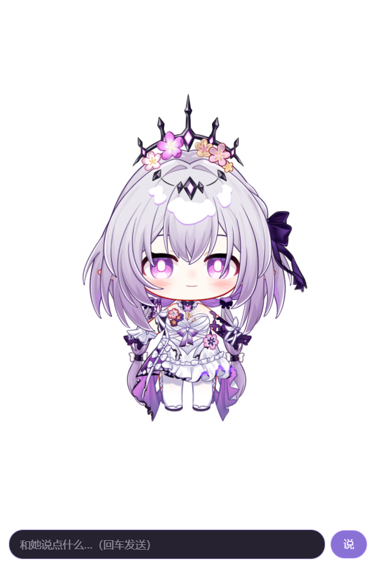
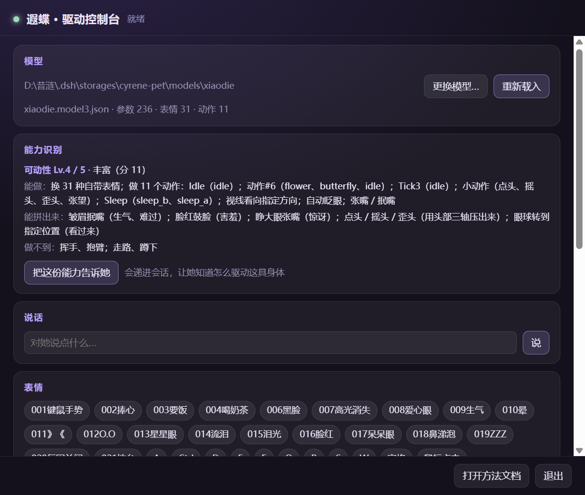
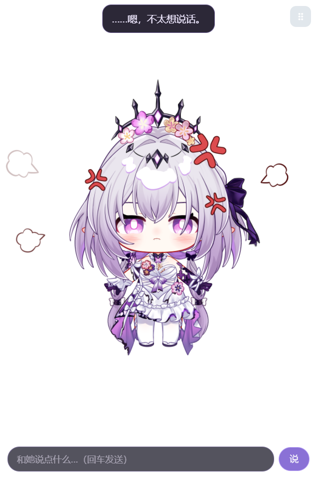

# 遐蝶 · Live2D 桌面驱动

一套自己写的 Live2D 桌面驱动：薄壳窗口 + 网页渲染，**不写死模型**——换一个模型目录，同一个驱动就能跑。

形态参考 [鲸语 jingyu-live2d](https://github.com/InariNGT-Ofiicial/jingyu-live2d) 的 `desktop-pet` 与 `web/pet.mjs` 思路，代码是本仓自写的，没有照搬。

> 换上它的原因：旧桌宠（dsh-cyrene-pet）拖动窗口会把尺寸撑大，改了七八轮没修好。
> 新壳只在系统层面搬窗、拖动中不调 `setSize`，连续拖动实测尺寸不变。



## 快速开始

双击 `start.cmd`。会开两扇窗：一扇是桌宠，一扇是控制台。

说话要经过 DSH 那边一个小桥插件：`dsh-castorice-bridge`（在 `<工作区>\.dsh\profiles\desktop\plugins\` 里）。它提供 `/castorice/say` 和 `/castorice/emoji/...`，顺便按工作区注入人设。旧桌宠插件 `dsh-cyrene-pet` 已经卸掉了，驱动不靠它。

给别的智能体看的说明书：`docs/AGENT-GUIDE.md`；人设：`persona/castorice.md` 和 `persona/castorice.persona.json`。



控制台里能做的事（不用碰命令行）：

- 看当前模型、参数/表情/动作数量
- **能力识别**：换模型或重新载入后自动分析——可动性等级（Lv.1–5）、能做哪些表情动作、用参数能拼出什么（害羞、生气、惊讶、点头……）、哪做不到（没有手臂/腿）；下面两颗按钮：「把这份能力告诉她」把结果递进 DSH 的会话，「发送自带人设」把 `persona/castorice.md` 递进去，接手的智能体照着扮演就行。
- 「更换模型…」选一个模型目录，驱动自己重新载入
- 点表情、点动作；「停下来」清掉动作
- **说话**：在输入框打字，按「说」，底部对话框就会显示
- 视线跟随鼠标 / 往左往右往上看
- 改窗口大小：拖「大小」滑杆按比例缩放（60%–180%），或直接填宽高；大小和位置会记住，下次启动照旧；置顶、显示或隐藏桌宠
- 「打开方法文档」直接看 `docs/METHOD.md`

命令行也可以（不带 `--gui` 就不开控制台）：

```bat
runtime\electron\electron.exe app --model "<工作区>\.dsh\storages\cyrene-pet\models\xiaodie" --catalog "data\catalog.json" --gui
```

换模型：

```bat
start.cmd "D:\某个模型目录"
```

## 互动



- **拖动**：按住模型本体拖，窗口跟着走；右上角那个小柄也能拖。小柄在鼠标离开立绘后会**再留五秒**，不然手一挪开它就淡掉、根本按不到；它走的是同一条自绘拖动，不交给系统原生拖，所以不会把窗口撑大。拖完尺寸不会变——150% 缩放下系统会让透明窗每次移动胖 1px，看门狗不拖动时不看，松手后才收一次。
- **回复带表情和动作**：我回话时句尾带 `[图:id]`、`[动作:名称]`，插件把它们摘下来——`[图:id]` 变成气泡左边的表情图（`xd-*` 还会顺带换脸），`[动作:名称]` 让模型点头、摇头、歪头、张望。网页聊天框里这两个方括号仍会显示成字。
- **点一下**：按点到的部位分七段——头、脸、肩、胸口、肚子、裙摆、脚踝，各自有本地反应；同时把「（风铃碰了碰你的脸。）」这样带部位的话递进 DSH 会话里（挑最新建的那条），我回的话会回到头顶气泡（最多 60 字）；等的时候气泡里转三个点，回话按字吐出来，十五秒还没回音才出本地那句。
- **对话框**：在角色头顶上，带头朝下的尾巴，几秒后自己淡掉。鼠标点、脚本、控制台「说话」框、窗口底部的输入框都能让它出现；等回复时转三个点，回复按字慢慢出来。
- **聊天框和桌宠同步**：在 DSH 里直接发消息，桌宠也会转三个点等你；你回完，气泡把回话逐字吐出来。驱动启动时会把地址登记到桥插件，会话事件通过 `/api/echo` 反推过来。
- **输入框**：桌宠窗口最下面那一行。点进去打字，回车或点「说」就把话递进 DSH 的会话（和触摸同一条路），她的回话出现在头顶气泡；递不进去会应一句「那边的会话没接上」。控制台里也还有一只「说话」框，那只只在本地说。
- **情绪**：控制台的「情绪」按钮（生气 / 难过 / 害羞 / 平静）。模型的表情文件多半只开特效，脸要另外用眉、嘴参数压出来——生气会皱眉抿嘴，难过会垂眉，害羞会挑眉鼓脸。点表情芯片时，009 / 006 / 014 / 015 / 016 会自动带上对应情绪。
- **回落**：表情和情绪 30 秒后自己回默认；这期间再换别的，会替换掉上一个并重新计时。回落是按墙钟对时的——窗口闲置、系统睡眠醒来也会立刻收，不会冻在最后一帧。
- 给脚本用：`{"cmd":"say","text":"……","duration":6000}`、`{"cmd":"reaction","zone":"head"}`、`{"cmd":"zone","x":233,"y":300}`（只算部位，不递话）、`{"cmd":"mood","name":"angry"}`。

## 命令行参数

| 参数 | 说明 |
| --- | --- |
| `--model <目录>` | 模型目录，里面要有 `*.model3.json`（只放一个模型最省事） |
| `--width <px>` `--height <px>` | 窗口尺寸，默认 420 × 640；换模型时可按比例调 |
| `--catalog <路径>` | 启动时把模型目录（参数表 / 表情 / 动作）写到这个文件 |
| `--shot <路径>` | 截图后自动退出，用来做无人值守验证 |
| `--debug-port <端口>` | 打开 Chromium 远程调试端口，排查渲染问题用 |
| `--gui` | 同时打开控制台窗口（`start.cmd` 默认带） |
| `--user-name <名字>` | 递进会话时怎么称呼摸她的人，默认「风铃」 |
| `--dsh-url <地址>` | DSH 的地址，默认 `http://127.0.0.1:54819` |

## 本地接口

驱动在 `127.0.0.1` 上随机端口起一个小服务，只对本机开放：

| 接口 | 作用 |
| --- | --- |
| `GET /api/state` | 窗口 bounds、屏幕信息、渲染层状态（fps / 表情 / 动作 / 视线） |
| `GET /api/model` | 当前模型的 model3 相对地址 |
| `GET /api/catalog` | 渲染层生成的模型目录（JSON） |
| `POST /api/command` | 驱动命令，见下 |
| `POST /api/shot` | `{"path":"D:\\...png","target":"pet"｜"control"}` 截当前窗口，做调试用 |

命令（`POST /api/command`，UTF-8 JSON）：

```jsonc
{ "cmd": "expression", "name": "016脸红" }   // 或 "index": 14；可选 "duration"（毫秒，默认 30000）
{ "cmd": "motion", "group": "小动作", "index": 0 }  // 或 "name": "点头"
{ "cmd": "say", "text": "……", "duration": 6000 }    // 对话框
{ "cmd": "reaction", "zone": "head" }        // head / body，随机反应
{ "cmd": "mood", "name": "angry" }           // angry / sad / shy / calm；也可带 "duration"
{ "cmd": "gaze", "x": -1, "y": 0.4 }         // 视线钉在某个方向（-1..1）
{ "cmd": "gaze", "off": true }               // 交还给窗口内鼠标
{ "cmd": "stop" }                            // 停掉当前动作/表情
{ "cmd": "state" }
```

## 目录

```
live2d-driver/
  app/            Electron 主进程（窗口 / 静态服务 / 命令转发 / 控制台 IPC）
  web/            渲染层（driver.mjs）、控制台（control.html + control.mjs）与 Live2D 库
  runtime/        Electron 运行时（自带一份，不依赖别人的目录）
  data/           启动时生成的 catalog.json
  docs/METHOD.md  接入新模型的方法
```

## 已知限制

- 只支持 Cubism 4 的 model3 模型（pixi-live2d-display + Live2D Cubism Core 5.1）。
- 没做 VTS / 麦克风口型；点击互动按上下半身分头 / 身两区，模型自己的 HitAreas 还没用上。
- 中文输入法下，上屏那一下回车会被输入法吃掉（不会发送）；上屏完再按回车，或点「说」。
- 本机 150% 缩放：窗口真实尺寸稳定，但 Electron 的 getSize / getBounds 会多报 1～2px，看门狗靠「差超过 2px 才动手」压住。
- 这是「驱动」不是「桌宠全家桶」：气泡、状态栏、记忆、DSH 会话读取还在旧插件那边，后续要逐块接过来。

## 依赖与许可

- [pixi.js](https://pixijs.com) 6.5.10、[@pixi/unsafe-eval](https://github.com/pixijs/pixijs) — MIT
- [pixi-live2d-display](https://github.com/guansss/pixi-live2d-display) cubism4 — MIT
- Live2D Cubism Core / Cubism Web Framework — Live2D Inc. 的授权条款，仅本地个人使用
- [Electron](https://www.electronjs.org) 43.3.0 — MIT
- 鲸语 jingyu-live2d — MIT（只参考了结构，没有复制代码）
